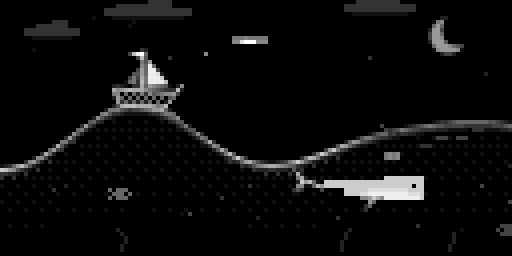
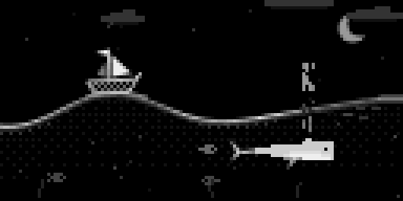
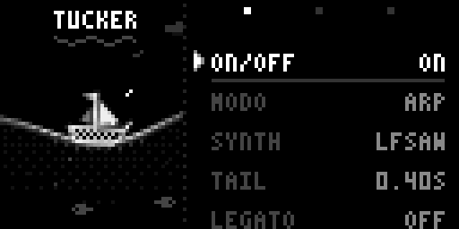
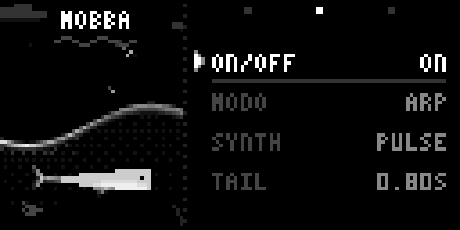
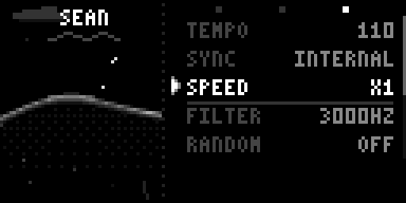

[English](README.md) · [Español](README.es.md) · [Français](README.fr.md) · **Deutsch** · [日本語](README.ja.md) · [中文](README.zh.md) · [हिन्दी](README.hi.md)

# umi

Ein Meer, das sich selbst spielt, für [monome norns](https://monome.org/docs/norns/).
*Umi* (海) heißt auf Japanisch „Meer“. Drei Figuren leben auf dem Bildschirm, und
jede ist eine Stimme: Die Wellen bestimmen die Noten, du steuerst das Wetter.


- **Tucker**, das Segelboot, fährt auf der Oberfläche: Die Höhe der Welle unter
  ihm ist seine Note
- **Mobba**, der Wal, schwimmt darunter mit einer eigenen, langsameren Linie
  und singt auf K3 mit Echo
- **Lea**, der Vogel, erscheint nur, solange du K2 hältst: ein gleitendes
  Legato-Solo
- **Sean** ist das Meer selbst: Tempo, Skala, Grundton, Filter, zufällige
  Gezeiten, Bitcrusher und ein Tape-Ausgang
- jede Stimme spielt ein **Arpeggio**, das der Welle folgt, oder einen
  **generativen** Gang durch die Skala; eine Figur seitlich zu bewegen
  transponiert sie
- der Seegang bestimmt die Zahl der Schritte: ruhige See = 2 Noten, hohe
  Wellen = 16
- eine ständige Windschicht, die mit dem Seegang wächst
- folgt der norns-Clock (intern, MIDI, Link oder crow); jede Einstellung ist ein
  Parameter (per MIDI steuerbar, in PSETs gespeichert), und der letzte Zustand
  bleibt erhalten

## Voraussetzungen

- norns (beliebig: shield, standard oder fates)
- sonst nichts: umi spielt von selbst, sobald es geladen ist

## Installation

In maiden:

```
;install https://github.com/buenosairesfront/umi
```

Dann **norns neu starten** (SYSTEM > RESTART), damit die neue Engine `Mar`
kompiliert wird, und **umi** unter SELECT laden.

> Wenn ein älteres Skript namens **mar** installiert ist, lösche es vorher
> (`dust/code/mar`): Beide bringen eine Engine namens `Mar` mit, und
> SuperCollider kompiliert keine zwei Klassen mit demselben Namen.

## Bedienung

Jede Taste und jeder Encoder überspringt das Intro.

### Das Meer


| Bedienelement | Funktion |
|---|---|
| E1 | Wind: von glatter See bis zu hohen Wellen (legt auch fest, wie viele Schritte jede Stimme spielt) |
| E2 | Tucker nach links / rechts (transponiert seine Linie um −8…+8 Skalenstufen) |
| E3 | Mobba nach links / rechts (dasselbe für sie) |
| K2 halten | Lea fliegt herein und spielt ein Solo; E2 bewegt sie; beim Loslassen fliegt sie langsam davon |
| K3 | Mobba singt eine Note nahe ihrer Position, und eine halbe Sekunde später gibt das Meer sie als Echo zurück, eine Quinte tiefer |
| K1 halten | öffnet das Panel der gewählten Figur (siehe unten) |






### Panels (K1 halten)

Solange K1 gehalten wird, zoomt die Szene auf eine Figur und ein Panel
gleitet herein.

| Bedienelement | Funktion |
|---|---|
| E1 | Figur wählen: Tucker, Mobba, Sean |
| E2 | Eintrag wählen |
| E3 | ihn ändern |



**Tucker** — on/off · Modus (arp / gen) · Synth (LFSaw, FM Bell, LFGauss,
Dream) · tail (Notenlänge, nur im Arp-Modus) · legato.



**Mobba** — on/off · Modus (arp / gen) · Synth (Pulse, Saw, SinOsc) · tail.



**Sean** — tempo · sync (Clock-Quelle) · speed (×1/4 … ×4) · filter ·
random (Gezeiten, die von selbst schneller und langsamer werden) · root ·
Skala (Dur, Moll-Varianten, Modi, Pentatonik, Ganzton, Blues, Zigeunermoll) ·
fx (keiner / Bitcrusher, mit bits und rate) · out mode (normal / tape, mit
amount).

### Speichern

Alles aus den Panels steht auch unter PARAMETERS > MAR, lässt sich also per
MIDI steuern und in PSETs speichern. Beim Verlassen des Skripts wird der
aktuelle Zustand in `~/dust/data/umi/mar_estado.pset` gespeichert und beim
nächsten Mal wiederhergestellt.

<!-- u-ma:more -->
**Mehr von U-MA:** alle Instrumente und Werkzeuge an einem Ort → [U-MA-Übersicht](https://github.com/buenosairesfront/U-ma/blob/main/README.de.md)
<!-- /u-ma:more -->

## Credits

Gemacht von [Buenos Aires Front](https://github.com/buenosairesfront) / U-MA.
Veröffentlicht unter der MIT-Lizenz.
