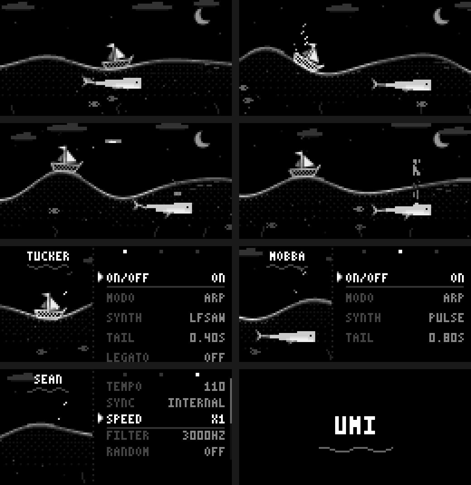

[English](README.md) · **Español** · [Français](README.fr.md) · [Deutsch](README.de.md) · [日本語](README.ja.md) · [中文](README.zh.md) · [हिन्दी](README.hi.md)

# umi

Un mar que se toca solo, para [monome norns](https://monome.org/docs/norns/).
*Umi* (海) es "mar" en japonés. Tres personajes viven en la pantalla y cada uno
es una voz: las olas deciden las notas y vos manejás el clima.



- **Tucker**, el velero, va sobre la superficie: la altura de la ola debajo
  de él es su nota
- **Mobba**, la ballena, nada abajo con su propia línea, más lenta, y con K3
  canta y el mar le devuelve el eco
- **Lea**, el ave, aparece solo mientras mantenés K2: un solo en legato que
  planea
- **Sean** es el mar mismo: escala, tónica y un filtro compartido por todas
  las voces
- cada voz toca un **arpegio** que sigue a la ola o un paseo **generativo**
  por la escala; mover un personaje hacia los costados lo transpone
- el oleaje fija la cantidad de pasos: mar calmo = 2 notas, olas grandes = 16
- una capa de viento constante que crece con el oleaje
- sigue al reloj de norns (interno, MIDI, Link o crow); cada ajuste es un
  parámetro (mapeable a MIDI, se guarda en PSET) y el último estado se recuerda

## Requisitos

- norns (cualquiera: shield, estándar o fates)
- nada más: umi suena solo apenas carga

## Instalación

Desde maiden:

```
;install https://github.com/buenosairesfront/umi
```

Después **reiniciá la norns** (SYSTEM > RESTART) para que compile el engine
nuevo `Mar`, y cargá **umi** desde SELECT.

> Si tenés instalado un script viejo llamado **mar**, borralo antes
> (`dust/code/mar`): los dos traen un engine llamado `Mar` y SuperCollider no
> compila dos clases con el mismo nombre.

## Controles

Cualquier tecla o encoder saltea la intro.

### El mar


| control | acción |
|---|---|
| E1 | viento: de mar en calma a olas grandes (no cambia la velocidad de las notas: esa la da el reloj) |
| E2 | mueve a Tucker a izquierda / derecha (transpone su línea −8…+8 grados de la escala) |
| E3 | mueve a Mobba a izquierda / derecha (lo mismo, para ella) |
| K2 mantenido | Lea entra volando y toca un solo; E2 la mueve; al soltar se va despacio |
| K3 | Mobba canta una nota cerca de donde está y medio segundo después el mar se la devuelve como eco, una quinta más grave |
| K1 mantenido | abre el panel (ver abajo) |


### Panel (K1 mantenido)

Mientras mantenés K1 entra un único panel: una sola lista de seis ajustes.

| control | acción |
|---|---|
| E2 | elegir ajuste |
| E3 | cambiarlo |

E1 sigue siendo el viento con el panel abierto.

| ajuste | valores |
|---|---|
| tucker | off / Dream / Bell / Gauss (su voz) |
| mobba | off / on |
| modo | arp / gen, para los dos |
| escala | mayor, menores, modos, pentatónicas, tonos enteros, blues, menor gitana |
| root | C … B |
| filter | 100–5000 Hz |

El tempo y la fuente del reloj son los de norns (PARAMETERS > CLOCK).

### Guardado

Los seis ajustes también están en PARAMETERS > UMI, así que se pueden mapear
a MIDI y guardar en PSET. Al salir del script el estado actual se guarda en
`~/dust/data/umi/umi_estado.pset` y vuelve la próxima vez.

<!-- u-ma:more -->
**Más de U-MA:** todos los instrumentos y herramientas en un solo lugar → [muestrario U-MA](https://github.com/buenosairesfront/U-ma/blob/main/README.es.md)
<!-- /u-ma:more -->

## Créditos

Hecho por [Buenos Aires Front](https://github.com/buenosairesfront) / U-MA.
Publicado con licencia MIT.
