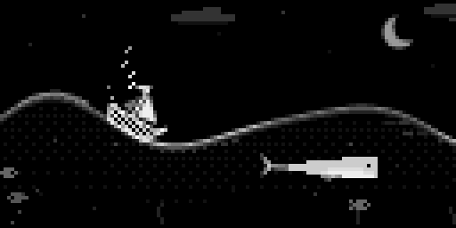
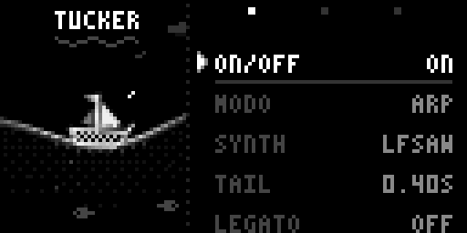
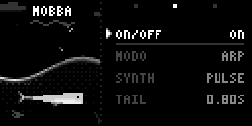
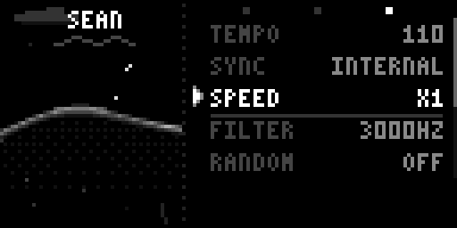

[English](README.md) · **Español** · [Français](README.fr.md) · [Deutsch](README.de.md) · [日本語](README.ja.md) · [中文](README.zh.md) · [हिन्दी](README.hi.md)

# umi

Un mar que se toca solo, para [monome norns](https://monome.org/docs/norns/).
*Umi* (海) es "mar" en japonés. Tres personajes viven en la pantalla y cada uno
es una voz: las olas deciden las notas y vos manejás el clima.


- **Tucker**, el velero, va sobre la superficie: la altura de la ola debajo
  de él es su nota
- **Mobba**, la ballena, nada abajo con su propia línea, más lenta, y con K3
  canta y el mar le devuelve el eco
- **Lea**, el ave, aparece solo mientras mantenés K2: un solo en legato que
  planea
- **Sean** es el mar mismo: tempo, escala, tónica, filtro, marea aleatoria,
  bit crusher y salida de cinta
- cada voz toca un **arpegio** que sigue a la ola o un paseo **generativo**
  por la escala; mover un personaje hacia los costados lo transpone
- el oleaje fija la cantidad de pasos: mar calmo = 2 notas, olas grandes = 16
- una capa de viento constante que crece con el oleaje
- sigue al reloj de norns (interno, MIDI, Link o crow); cada ajuste es un
  parámetro (mapeable a MIDI, se guarda en PSET) y el último estado se recuerda

## Requisitos

- norns (cualquiera: shield, estándar o fates)
- nada más: umi suena solo apenas carga

## Instalación

Desde maiden:

```
;install https://github.com/buenosairesfront/umi
```

Después **reiniciá la norns** (SYSTEM > RESTART) para que compile el engine
nuevo `Mar`, y cargá **umi** desde SELECT.

> Si tenés instalado un script viejo llamado **mar**, borralo antes
> (`dust/code/mar`): los dos traen un engine llamado `Mar` y SuperCollider no
> compila dos clases con el mismo nombre.

## Controles

Cualquier tecla o encoder saltea la intro.

### El mar


| control | acción |
|---|---|
| E1 | viento: de mar en calma a olas grandes (también fija cuántos pasos toca cada voz) |
| E2 | mueve a Tucker a izquierda / derecha (transpone su línea −8…+8 grados de la escala) |
| E3 | mueve a Mobba a izquierda / derecha (lo mismo, para ella) |
| K2 mantenido | Lea entra volando y toca un solo; E2 la mueve; al soltar se va despacio |
| K3 | Mobba canta una nota cerca de donde está y medio segundo después el mar se la devuelve como eco, una quinta más grave |
| K1 mantenido | abre el panel del personaje elegido (ver abajo) |




### Paneles (K1 mantenido)

Mientras mantenés K1 la escena se acerca a un personaje y entra un panel.

| control | acción |
|---|---|
| E1 | elegir personaje: Tucker, Mobba, Sean |
| E2 | elegir ítem |
| E3 | cambiarlo |



**Tucker** — on/off · modo (arp / gen) · synth (LFSaw, FM Bell, LFGauss,
Dream) · tail (largo de nota, solo en modo arp) · legato.



**Mobba** — on/off · modo (arp / gen) · synth (Pulse, Saw, SinOsc) · tail.



**Sean** — tempo · sync (fuente del reloj) · speed (×1/4 … ×4) · filter ·
random (una marea que se acelera y se frena sola) · root · escala (mayor,
menores, modos, pentatónicas, tonos enteros, blues, menor gitana) · fx (no /
bit crusher, con bits y rate) · out mode (normal / tape, con amount).

### Guardado

Todo lo de los paneles también está en PARAMETERS > MAR, así que se puede
mapear a MIDI y guardar en PSET. Al salir del script el estado actual se
guarda en `~/dust/data/umi/mar_estado.pset` y vuelve la próxima vez.

<!-- u-ma:more -->
**Más de U-MA:** todos los instrumentos y herramientas en un solo lugar → [muestrario U-MA](https://github.com/buenosairesfront/U-ma/blob/main/README.es.md)
<!-- /u-ma:more -->

## Créditos

Hecho por [Buenos Aires Front](https://github.com/buenosairesfront) / U-MA.
Publicado con licencia MIT.
